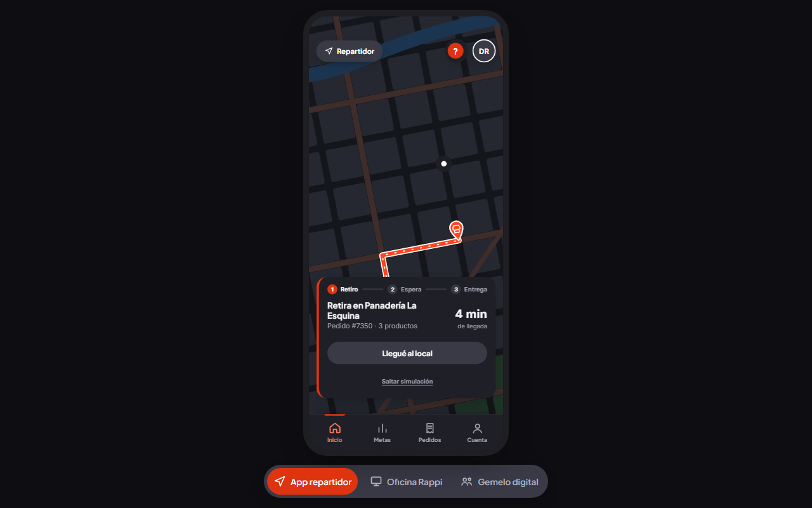
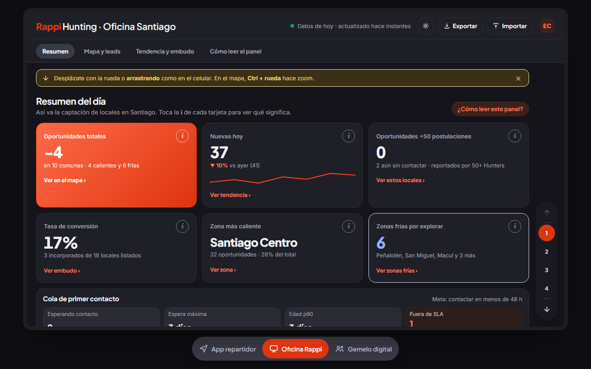
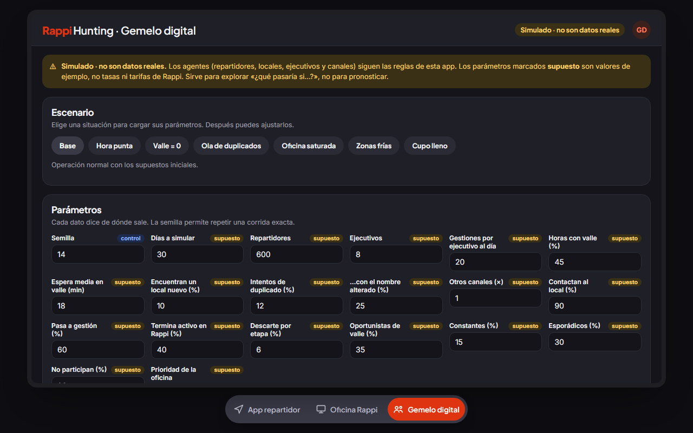

# Rappi Hunters · Prototipo y gemelo digital

> **¿Y si los repartidores aprovecharan sus tiempos de espera para descubrir locales que aún no están en Rappi?**
> Prototipo funcional de un programa de captación de locales hecho por repartidores, con una Oficina para gestionarlos y un **gemelo digital** que simula si las reglas del programa aguantan a escala.

<p align="center">
  <a href="https://fx010.github.io/Dlab-sem-2/"></a>
  <a href="docs/Informe_Pruebas.md"></a>
</p>

<p align="center">
  
  
  
  
</p>

<p align="center">
  
  
  
</p>
<p align="center"><sub><b>App del repartidor</b> · <b>Oficina</b> · <b>Gemelo digital</b></sub></p>

Proyecto del **dLab UDD 2026 · Desafío 18 «Repartidores como Hunters»**, para Rappi Chile.
**Versión actual: v15** (mapa real con calles, pines en el mapa de la oficina, agrupación de pines y leyenda por fuente). Todo corre en el navegador: un único archivo HTML, sin servidor, sin dependencias y sin instalar nada.

## Qué incluye

| Vista | Para quién | Qué hace |
|---|---|---|
| **App repartidor** | Repartidor | Pedido en curso, tiempo de valle, carta de invitación al **Modo Hunter**, formulario para reportar un local (fachada + carta), cupo de 5 leads activos, código QR personal y seguimiento de cada lead. |
| **Oficina Rappi** | Equipo comercial | Resumen del día, mapa con zonas calientes y frías, cola de primer contacto con SLA de 48 h, embudo de conversión, importar y exportar. |
| **Gemelo digital** | Equipo del proyecto | Simulación basada en agentes (repartidores, locales, ejecutivos) con escenarios, semilla fija y chequeo automático de invariantes. |

**Reglas de diseño que cuidamos**
- Con un pedido en curso el Modo Hunter queda **bloqueado**: las entregas siempre van primero.
- No hay metas obligatorias ni rankings de repartidores individuales: los resultados son agregados.
- Todo dato simulado está rotulado «Simulado», y cada parámetro inventado, «supuesto».

## Lo que descubrió el gemelo digital

Con 600 repartidores y 8 ejecutivos durante 30 días simulados:

1. **La oficina es el cuello de botella, no el repartidor.** Con 1.000 repartidores el primer contacto pasa de ~17 h a ~109 h.
2. **El tope de 5 leads activos no protege a la oficina:** limita a cada persona, no el volumen total.
3. **El anti-spam por texto deja pasar ~1 de cada 4 duplicados** si el nombre viene alterado; conviene sumar ubicación y revisión humana.
4. **Priorizar el SLA puede ser un espejismo:** baja los leads fuera de plazo, pero la conversión cae de ~19 % a ~7 %.
5. **Sin tiempo de valle no hay programa:** con espera cercana a 0, los leads de Hunters caen a 0.
6. **Las comunas frías casi no se cubren solas** (~9 % de los leads), así que hace falta una señal que dirija a los Hunters.

> Son resultados de un **modelo con parámetros de ejemplo**, no datos de Rappi. Sirven para explorar «¿qué pasaría si…?», no para pronosticar. El método, los límites y los 7 hallazgos de la v13 están en el [informe completo](docs/Informe_Pruebas.md).

## Cómo probarlo

- **En línea:** abre la [demo](https://fx010.github.io/Dlab-sem-2/).
- **En local:** descarga el repositorio y abre `index.html` en el navegador.
- **Autopruebas del gemelo:** en la vista *Gemelo digital*, botón **Autoprueba** (determinismo, aislamiento, reglas reales, extremos y pruebas de mutación).

## Estructura

```
index.html                 Prototipo publicado (GitHub Pages) · versión actual v15
Rappi_Hunter_v15.html      Misma versión, con nombre de entrega
Rappi_Hunter_v14.html      Versión anterior (base del informe de pruebas)
docs/Informe_Pruebas.md    Informe de pruebas de la v14 y resultados de la simulación
docs/qa/                   Hallazgos de la v13 y datos de las corridas (JSON)
docs/img/                  Capturas
```

## Tecnología

HTML · CSS · JavaScript puro · Simulación basada en agentes · Leaflet para el mapa real (opcional).

## Límites

Es un prototipo de pruebas: guarda datos solo en el navegador (`localStorage`), no se probó con GPS real ni en dispositivos físicos, y los documentos legales del proyecto requieren revisión de un abogado. Detalle en la sección 2 del informe.
